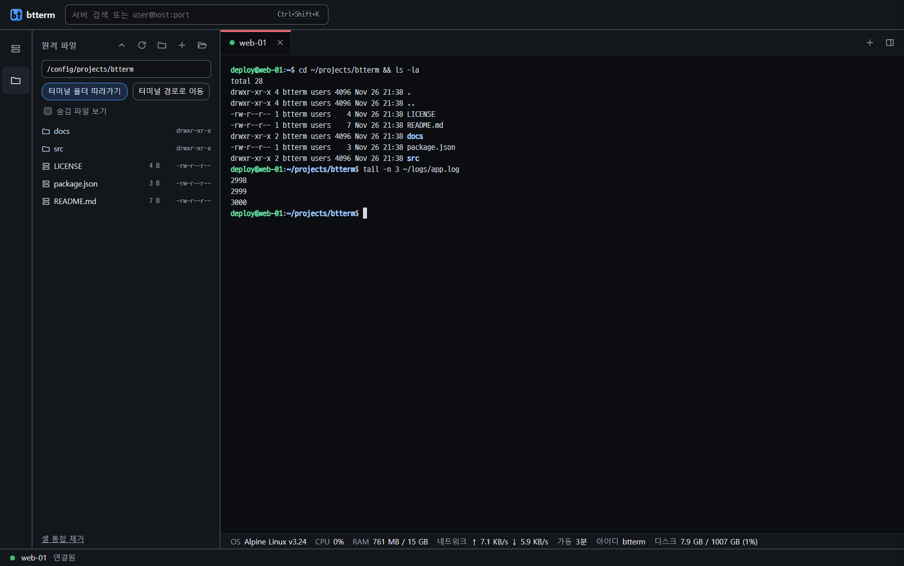
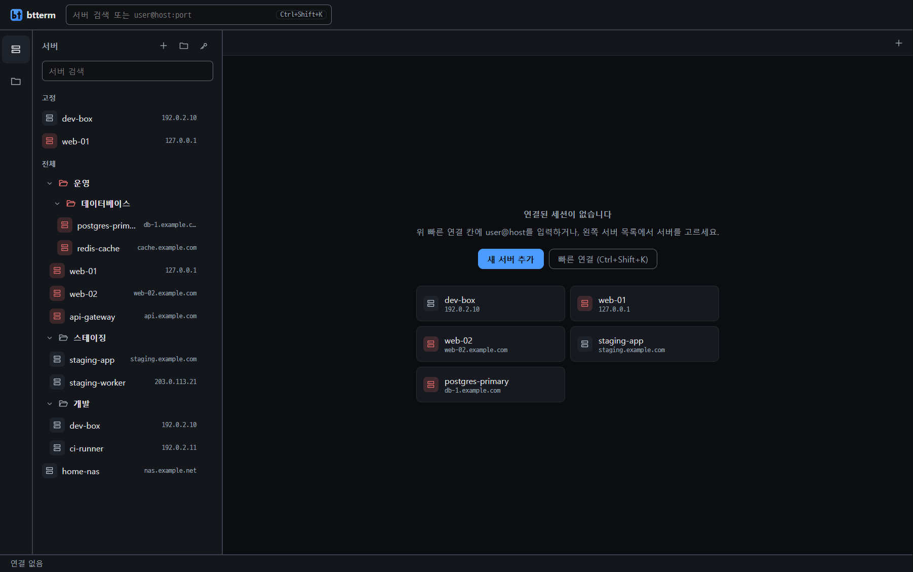
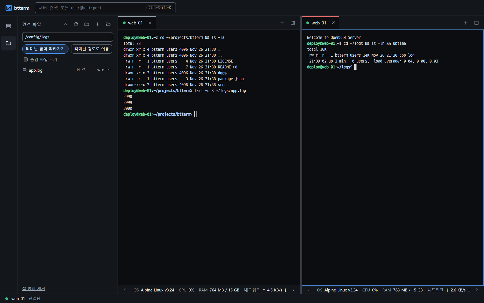
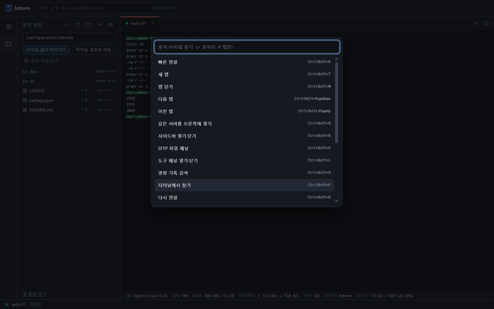
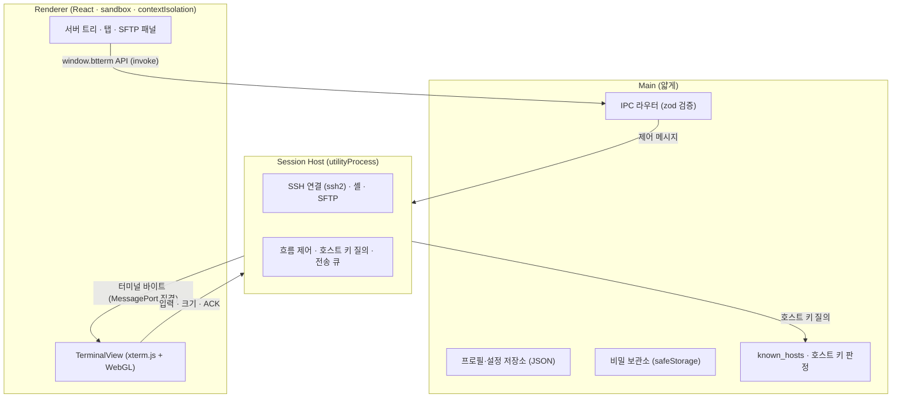

# btterm

**터미널과 파일 전송을 한 흐름으로.** Windows 우선(macOS 대응 중) SSH 통합 클라이언트.

[](LICENSE)


서버 목록에서 바로 접속하고, 터미널에서 `cd`하면 옆의 SFTP 패널이 같은 폴더로 따라온다. 계정 가입도, 유료 잠금도, 원격 수집도 없는 로컬 우선 도구다.

1인 개인 프로젝트다. 공식 바이너리는 없고, 지원·응답은 보장하지 않으며, 외부 PR은 받지 않는다([CONTRIBUTING](CONTRIBUTING.md), 보안 문제는 [SECURITY](SECURITY.md)).



---

## 목차

- [왜 만들었나](#왜-만들었나)
- [장점](#장점)
- [화면](#화면)
- [기능](#기능)
- [설치](#설치)
- [처음 쓰기](#처음-쓰기)
- [단축키](#단축키)
- [데이터와 보안](#데이터와-보안)
- [구성](#구성)
- [개발](#개발)
- [현재 상태와 범위](#현재-상태와-범위)
- [라이선스](#라이선스)

---

## 왜 만들었나

Windows에서 여러 리눅스 서버를 관리하면 "접속 → 셸 작업 → 파일 주고받기"를 하루에도 수십 번 반복한다. 이 일을 한 창에서 해 주는 도구는 이미 있지만, 쓰다 보면 비슷한 불편이 쌓인다.

- 좋은 기능은 유료판이나 계정 가입 뒤에 있다.
- 세션 하나를 설정하려면 탭이 열 개 넘는 대화상자를 거쳐야 한다.
- 설정이 레지스트리나 독자 형식에 흩어져 있어 백업·이전이 번거롭다.
- 대량 출력이나 SFTP에서 멈추거나 느려진다.

btterm은 **"개발자 한 명의 매일 쓰는 SSH 작업을 이 앱 하나로 끝낸다"** 를 목표로 처음부터 새로 만들었다. 기능 수보다 자주 쓰는 흐름이 빠르고 안전한 것을 우선한다.

## 장점

| | |
|---|---|
| **터미널을 따라가는 SFTP** | 셸에서 폴더를 옮기면 SFTP 패널도 같은 경로로 이동한다(OSC 7 셸 통합, 동의 후 설치·제거). 파일을 찾으려고 경로를 다시 칠 필요가 없다. |
| **로컬 우선, 전 기능 무료** | 계정·로그인·구독 없이 모든 기능을 쓴다. 텔레메트리와 크래시 리포트 자동 업로드가 없다. |
| **안전한 기본값** | 호스트 키가 바뀌면 연결을 막는다. 비밀번호·passphrase와 보관소로 가져오거나 생성한 개인키는 암호화해 저장하고(암호화 키는 OS 보안 저장소가 보호), 화면(renderer) 프로세스로 보내지 않는다. 터미널 출력이 클립보드를 쓰거나 읽고 창을 조작하지 못하게 막는다. |
| **대량 출력에도 멈추지 않음** | 세션은 별도 프로세스에서 돌고, 터미널 바이트는 메인 프로세스를 거치지 않고 화면으로 직결된다. 흐름 제어(ACK)로 `yes` 같은 폭주 출력 중에도 Ctrl+C로 멈출 수 있다(부하 상황 기준은 조정 중). |
| **설정이 읽을 수 있는 파일** | 서버 목록·설정은 스키마 버전이 붙은 JSON이다. 원자적 저장과 `.bak` 백업, 버전이 오를 때마다 데이터 폴더 스냅샷을 자동으로 남긴다. |
| **한글 터미널 품질** | 한글 출력·셀 폭, 한글 경로(OSC 7)를 테스트로 검증한다. 한국어 UI. |
| **터미널 키를 빼앗지 않음** | 앱 단축키는 Ctrl+Shift 계열만 쓴다. Ctrl+W, Ctrl+R 같은 키는 그대로 원격 셸로 간다. |
| **테스트로 지키는 코드** | 도메인 로직은 프레임워크와 분리한 순수 TypeScript로 TDD 했다. 단위 테스트 880여 개, Docker sshd 통합 테스트, Playwright E2E가 있다. |

## 화면

| 서버 목록 | 칸 분할 + 서버 상태 줄 |
|---|---|
|  |  |
| **명령 팔레트** (Ctrl+Shift+P) | |
|  | |

> 화면의 서버 목록은 예시 데이터이고, 터미널은 테스트용 Docker sshd에 접속한 모습이다.

## 기능

**서버 관리**
- 그룹 트리(중첩·끌어 놓기·고정), 퍼지 검색, 최근 접속 서버 카드
- 그룹 기본값 상속(포트·계정·아이콘·탭 색·연결 직후 명령), 상속 출처 표시
- 빠른 연결 한 칸(`user@host:port`, `ssh -p` 명령 붙여넣기)
- `~/.ssh/config` 가져오기(Include·와일드카드, `ProxyCommand` 같은 실행 항목은 승인 전까지 비활성)

**터미널**
- 탭, 칸 분할(최대 8칸, 칸마다 탭바), 탭 이름·색, 지난 실행의 탭 다시 열기
- 끊긴 연결 자동 재접속(같은 탭), 절전 복귀 뒤 연결 확인
- 찾기, 링크 열기(확인 후), 안전한 붙여넣기(제어문자 제거, 여러 줄 확인)
- 터미널 테마 9종, 글꼴·크기·커서, 화면 모드(시스템·라이트·다크)
- 서버 상태 줄(OS·CPU·메모리·네트워크·디스크·가동 시간)
- 명령 기록 검색(원격 bash·zsh 기록, 비밀 패턴 마스킹, 실행 없이 입력만)
- 스니펫(`{{변수}}`, production 서버의 `sudo` 실행 확인)
- 명령 팔레트(동작·서버·탭)

**파일**
- SFTP 패널: 탐색, 새 폴더, 이름 변경, 권한, 삭제, 끌어 놓아 업로드
- 전송 큐(취소·재시도·충돌 질의), 폴더 재귀 전송, 실패한 전송 이어받기
- 원격 파일 로컬 편집: 저장을 감지해 업로드 여부를 묻는다(실행 파일 형식은 차단)

**키와 호스트**
- 인증: 비밀번호, 개인키(OpenSSH·PEM, passphrase), keyboard-interactive(OTP), SSH agent(Windows OpenSSH, macOS `SSH_AUTH_SOCK`)
- 키 관리: 가져오기·경로 참조, Ed25519·RSA 4096 생성, 내보내기, 지문·사용처 표시
- 서버에 공개키 등록(`authorized_keys`에 없을 때만 덧붙임, 권한 700/600 확인)
- 알려진 호스트 관리(btterm 항목만 삭제, `~/.ssh/known_hosts`는 읽기 전용)

## 설치

### 설치 파일

**이 저장소는 설치 파일을 배포하지 않는다.** 다른 곳에서 받은 btterm 설치 파일은 비공식이며, SSH 비밀번호와 키를 다루는 프로그램이므로 쓰지 않는다. 코드 서명이 없고 배포 전 조건([PRD §6.2·§9.6·§10](docs/PRD.md))을 아직 채우지 않아, 설치 파일은 소스에서 직접 만든다. 아래 경고 우회 안내는 직접 빌드한 파일에만 해당한다.

### 소스에서 설치 파일 만들기

준비물:

| 항목 | 버전 |
|---|---|
| Node.js | 24(`client/.nvmrc`, Electron 내장 Node와 같은 메이저) |
| pnpm | 11.1.3(`corepack enable`이면 자동) |
| Git | 아무 최신 버전 |
| macOS만 | Xcode Command Line Tools(`xcode-select --install`) |

```sh
git clone https://github.com/al8bright/btterm.git
cd btterm
corepack enable
pnpm run bootstrap      # 의존성 설치(+ git 훅)
```

**Windows**

```sh
pnpm package:win
```

`client/desktop/release/<버전>/btterm-Setup-<버전>.exe`가 생긴다(`SHA256SUMS.txt` 함께). 실행해 설치한다. 설치 방식에서 "현재 사용자만"을 고르면 관리자 권한 없이 설치된다(설치 폴더는 바꿀 수 있다).

- 처음 실행할 때 "Windows의 PC 보호" 창이 뜨면 **추가 정보 → 실행**을 누른다(서명이 없는 파일이라 나오는 경고다).

**macOS** (맥에서만 만들 수 있다)

```sh
pnpm package:mac
```

`client/desktop/release/<버전>/`에 Apple Silicon·Intel 공용(universal) dmg가 생긴다. 열어서 `btterm`을 응용 프로그램 폴더로 옮긴다.

- 공증하지 않은 ad-hoc 서명이다. 만든 맥에서는 바로 열린다. 다른 맥으로 옮기면 Gatekeeper가 막으므로 **시스템 설정 → 개인정보 보호 및 보안** → "그래도 열기"를 누른다(macOS 14 이하는 Control+클릭 → 열기).

### 업데이트

자동 업데이트는 없다. 새 버전 설치 파일로 덮어 설치하면 서버 목록·설정·키는 그대로 남는다. 새 버전 첫 실행 때 이전 데이터 폴더를 스냅샷으로 자동 보관한다.

macOS는 ad-hoc 서명이라 새 버전 첫 실행 때 키체인 접근 암호를 묻는다. 거부하면 저장된 비밀을 쓸 수 없다.

## 처음 쓰기

1. **서버 추가**: 사이드바의 `+`로 서버를 만들거나, 빠른 연결 칸에 `user@host`를 입력한다. `~/.ssh/config`가 있으면 빈 목록의 **ssh_config 가져오기**로 한 번에 등록한다.
2. **접속**: 서버를 더블클릭하면 새 탭에서 연결한다. 처음 보는 호스트 키는 지문을 확인하고 저장한다.
3. **파일**: SFTP 패널을 열고, 셸 통합을 설치하면(한 번, 동의 후) 터미널의 현재 폴더를 따라간다. 파일을 끌어 놓으면 올라간다.
4. **더 빠르게**: Ctrl+Shift+K로 서버를 찾고, Ctrl+Shift+P로 모든 동작을 검색한다.

## 단축키

Windows 기준(macOS는 Cmd 계열). 전체 목록은 [DESIGN §8.1](docs/DESIGN.md#81-단축키-단일-원천).

| 동작 | Windows | macOS |
|---|---|---|
| 서버 검색·빠른 연결 | Ctrl+Shift+K | Cmd+Shift+K |
| 명령 팔레트 | Ctrl+Shift+P | Cmd+Shift+P |
| 새 탭 / 탭 닫기 | Ctrl+Shift+T / Ctrl+Shift+W | Cmd+T / Cmd+W |
| N번째 탭 | Ctrl+Shift+1~9 | Cmd+1~9 |
| 같은 서버로 오른쪽 분할 | Ctrl+Shift+D | Cmd+D |
| 칸 포커스 이동(칸 2개 이상) | Ctrl+Alt+방향키 | Cmd+Option+방향키 |
| 복사 / 붙여넣기 | Ctrl+Shift+C / Ctrl+Shift+V | Cmd+C / Cmd+V |
| 터미널 검색 | Ctrl+Shift+F | Cmd+F |
| 재접속 | Ctrl+Shift+R | Cmd+Shift+R |
| 도구 패널 / 명령 기록 | Ctrl+Shift+L / Ctrl+Shift+H | Cmd+Shift+L / Cmd+Shift+H |

## 데이터와 보안

- **저장 위치**: 운영체제의 앱 데이터 폴더(Electron `userData`). 서버 목록·설정·비밀 보관소는 JSON, 그 밖에 btterm 전용 `known_hosts`, 로그(`logs/`), 업그레이드 스냅샷(`snapshots/`).
- **비밀 정보**: 비밀번호·passphrase와 보관소로 가져오거나 생성한 개인키는 AES-256-GCM으로 암호화하고(경로로 참조한 키 파일은 원래 자리에 그대로 둔다), 그 키는 OS 보안 저장소(Windows DPAPI, macOS 키체인 — Electron `safeStorage`)로 보호한다. 보안 저장소를 쓸 수 없으면 비밀 저장을 끈다(평문으로 저장하지 않는다).
- **호스트 키**: 모든 연결에서 검증하고, 저장된 키와 다르면 차단한다. 우회 옵션이 없다.
- **터미널 출력은 믿지 않는다**: OSC 52 클립보드 요청은 처리하지 않는다(쓰기·읽기 모두), 링크는 `http(s)`만 확인 후 열기, 창 조작 이스케이프 무시.
- **로그**: 비밀번호·토큰 같은 키 이름과 값 패턴을 가려서 기록한다.
- **네트워크**: SSH 접속 말고는 아무 데도 연결하지 않는다. 텔레메트리·자동 업데이트·크래시 업로드가 없다.
- **Electron 보안 기본선**: `contextIsolation`, `sandbox`, `nodeIntegration: false`, CSP, 권한 요청 거부, 출시 빌드 DevTools 끔, Electron Fuses.

전체 보안 불변 조건은 [AGENTS.md §4](AGENTS.md#4-보안-불변-조건-sec-n-예외-없음)에 있다.

## 구성

### 프로세스 구조



- **Session Host**: SSH 연결은 별도 프로세스(`utilityProcess`)에서 돈다. 연결이 죽거나 출력이 폭주해도 UI와 메인 프로세스가 멈추지 않는다.
- **MessagePort 직결**: 터미널 바이트는 메인 프로세스를 거치지 않는다. 화면이 받은 만큼 ACK를 보내고, 밀리면 SSH 채널을 잠시 멈춘다.
- **경계 검증**: 프로세스 사이를 오가는 모든 메시지는 zod 스키마로 런타임에 검증한다. renderer는 preload가 준 도메인 API(`window.btterm`)만 쓴다.

### 저장소 구조

```
btterm/
├─ client/                 # 앱 (pnpm 워크스페이스)
│  ├─ core/                # 도메인·포트·IPC 스키마. Node·Electron·DOM 의존 없음(빠른 단위 테스트)
│  ├─ ui/                  # React 화면. window.btterm 인터페이스에만 의존
│  ├─ desktop/             # Electron
│  │  └─ src/  main/  preload/  session-host/  platform/  renderer/
│  └─ scripts/             # 검사(AC·커밋 메시지·비밀·라이선스)·패키징·스모크
├─ docs/                   # PRD, PLAN, DESIGN, 결정 기록, QA
└─ AGENTS.md               # 아키텍처 경계·보안 불변 조건·작업 규칙
```

경계는 린트로 강제한다. `core`는 Node·Electron을 import할 수 없고, ssh2는 session host 밖에서 import할 수 없으며, OS 분기는 `platform` 폴더 안에서만 한다(ESLint·dependency-cruiser).

### 기술 스택

| 영역 | 사용 |
|---|---|
| 런타임 | Electron 44 (Node 24) |
| UI | React 19, TypeScript 6 |
| 터미널 | xterm.js 6 (WebGL 렌더러, DOM 폴백, unicode11) |
| SSH | ssh2 1.17 (`SshTransport` 포트 뒤) |
| 검증 | zod 4 |
| 빌드 | electron-vite, electron-builder (NSIS, dmg) |
| 테스트 | Vitest, Playwright(Electron), Docker sshd |

## 개발

```sh
pnpm run bootstrap   # 의존성 + git 훅
pnpm dev             # 개발 실행
pnpm test            # 단위 테스트
pnpm verify          # lint · format · typecheck · 단위 · AC 매트릭스 · 비밀·라이선스·audit 검사
pnpm verify:full     # + 통합(Docker sshd) · E2E(Playwright)
```

- 통합·E2E 테스트는 Docker로 띄운 sshd에만 접속한다. 실제 서버나 사용자의 `~/.ssh`에는 쓰지 않는다.
- 작업 절차(TDD, 구조/행위 커밋 분리), 아키텍처 경계, 보안 불변 조건은 [AGENTS.md](AGENTS.md)를 따른다.
- 요구사항은 [docs/PRD.md](docs/PRD.md), 단계 계획은 [docs/PLAN.md](docs/PLAN.md), 디자인·단축키는 [docs/DESIGN.md](docs/DESIGN.md).

버그 제보와 제안은 [Issues](https://github.com/al8bright/btterm/issues)로 받는다. 보안 문제는 Issues가 아니라 [SECURITY.md](SECURITY.md)의 경로로 알린다.

## 현재 상태와 범위

- **버전 0.1.1**. Windows 11(x64)에서 매일 쓰는 단계(M1 핵심 흐름 완료), macOS 대응 진행 중.
- **아직 없는 것**: 포트 포워딩, 로컬 터미널(PowerShell·zsh), 인증서·FIDO 키 인증, 스니펫 폴더·모든 탭 실행.
- **넣지 않기로 한 것**: 계정·동기화, 자동 업데이트. 개인 도구에 서버 운영이 필요 없어 범위 밖으로 두었다(나중에 다시 검토, [결정 기록](docs/decisions/2026-11-26-public-scope.md)).

## 라이선스

[MIT](LICENSE) © 2026 Ethan

btterm은 독립 프로젝트로 MobaXterm, Termius 등 다른 제품과 관계가 없다. 그 제품들의 코드·에셋·명칭을 쓰지 않는다([클린룸 원칙](AGENTS.md#5-클린룸라이선스)). MobaXterm은 Mobatek, Termius는 Termius Corporation의 상표이며, 제품명은 비교·상호운용 설명에만 쓴다. 서드파티 고지는 [THIRD_PARTY_NOTICES.md](THIRD_PARTY_NOTICES.md).
